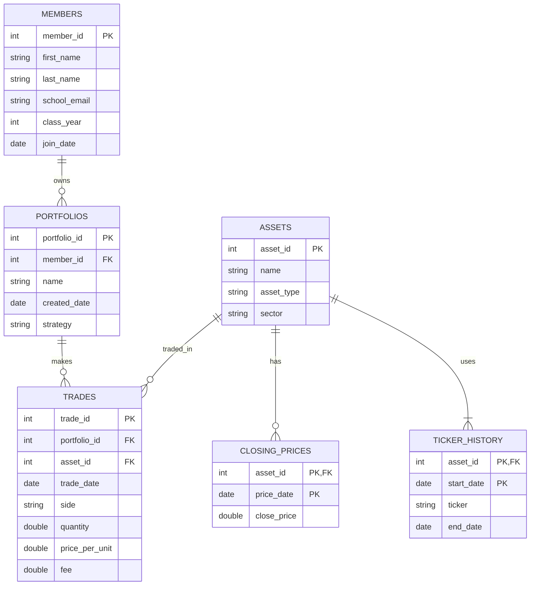

# The Scenario

**Scenario B — Babson Investment Club**

The Babson Investment Club manages paper portfolios for its members. The club needs a database to track members, portfolios, assets, trades, and historical closing prices.

The database will help the club understand what each portfolio owns, its trading history, and the value of its investments.

# The ERD

# What One Row Means
- MEMBERS: One row represents one member of the Babson Investment Club and their personal and membership information.

- PORTFOLIOS: One row represents one investment portfolio owned by a club member.

- ASSETS: One row represents one investment asset, such as a stock, ETF, or cryptocurrency.

- TICKER_HISTORY: One row represents the ticker symbol used by an asset during a specific period.

- TRADES: One row represents one transaction in which a portfolio buys or sells an asset.

- CLOSING_PRICES: One row represents the closing price of one asset on a specific date.

# Design Choices
