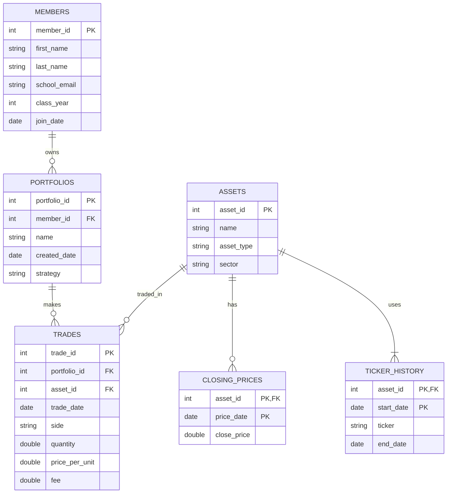

# The Scenario

**Scenario B — Babson Investment Club**

The Babson Investment Club manages paper portfolios for its members. The club needs a database to track members, portfolios, assets, trades, and historical closing prices.

The database will help the club understand what each portfolio owns, its trading history, and the value of its investments.

# The ERD

# What One Row Means
- MEMBERS: One row represents one member of the Babson Investment Club and their personal and membership information.

- PORTFOLIOS: One row represents one investment portfolio owned by a club member.

- ASSETS: One row represents one investment asset, such as a stock, ETF, or cryptocurrency.

- TICKER_HISTORY: One row represents the ticker symbol used by an asset during a specific period.

- TRADES: One row represents one transaction in which a portfolio buys or sells an asset.

- CLOSING_PRICES: One row represents the closing price of one asset on a specific date.

# Design Choices
1. Primary Keys

I choose to use unique IDs for members, portfolios, assets, and trades to make it easier to identify each record without confusion. For example, school emails and stock ticker symbols can change over time, but their unique IDs stay the same. This helps keep the database organized and prevents problems when information changes.

2. Optional Relationships

Some relationships in my database are optional. For example, a member does not need to own a portfolio, and an asset can exist without having any trades. However, every portfolio must belong to one member, and every trade must be linked to a portfolio and an asset.

3. Rules the Database Cannot Enforce

One rule that the database cannot enforce with a simple constraint is preventing a portfolio from selling more shares than it owns. This is because the database needs to consider previous purchases and sales to calculate the available shares. I will use an SQL query to check the trading history and identify any transactions that break this rule.

4. Reviewing the AI-Generated ERD

I checked the relationship between MEMBERS and PORTFOLIOS in the ERD. I wanted to make sure each portfolio belongs to one member, while a member can own multiple portfolios or none. The diagram correctly represents this relationship and follows the business rules.